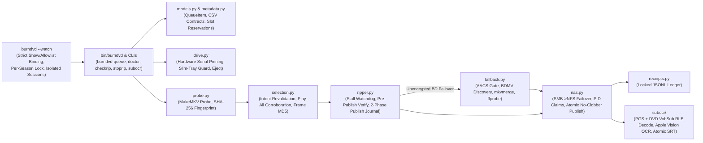

# burndvd

[](https://github.com/trevorgordon981/burndvd-makemkv/actions/workflows/ci.yml)

Decoupled macOS optical-disc ripping, crash-recoverable NAS publication, unencrypted-Blu-ray `mkvmerge` fallback, multi-drive box-set watch automation, and Apple Vision Blu-ray HDMV PGS / DVD VobSub subtitle OCR toolkit for Plex/Jellyfin media libraries.

## The Problem

Ripping a single optical disc interactively is easy; unattended multi-drive TV box-set ripping fails in subtle, destructive ways:

- **Silent episode overwrites & numbering races:** Two optical drives ripping the same TV season concurrently can claim overlapping `SxxEyy` episode slots or clobber already-published files over SMB/NFS.
- **Unrelated media misrouting:** An unattended watcher that accepts any inserted disc without strict show/season/allowlist binding can rip a movie or wrong-season disc into the wrong TV season directory.
- **Crash windows during NAS publication:** A power loss or process crash between atomic rename and commit-journal persistence can leave staged sources deleted or cause replay runs to self-collide on their own published files.
- **Misattributed multi-drive status & drifting JSON:** Two drives holding discs with identical volume labels can cause status dashboards to attribute an active rip to the wrong physical drive, and ad-hoc JSON envelopes break monitoring scripts.
- **Optical & subtitle edge cases:** Play-All compilation titles duplicate episodes, MakeMKV occasionally stalls on unencrypted BDs, slim-tray drives pop open if sent tray-respin commands, and bitmap PGS/VobSub subtitles require OCR for broad player compatibility.

## Architecture



## What `burndvd` Contributes vs MakeMKV / `ffmpeg` / `mkvmerge`

`burndvd` does not reimplement optical decryption, Matroska muxing, or video decoding — it orchestrates battle-tested media tools with strict operational safety invariants:

| Layer | External Tool Responsibility | `burndvd` Responsibility |
| --- | --- | --- |
| **Disc reading & remux** | `makemkvcon` reads/decrypts optical titles; `mkvmerge` remuxes unencrypted BDMV playlists on fallback | Hardware-serial drive pinning, slim-tray protection, Play-All structural/frame-MD5 corroboration, fail-closed AACS gate before `mkvmerge` fallback |
| **Media verification** | `ffmpeg` / `ffprobe` decode-verify streams and probe durations/frames | Pre-publish verification gate (bad/truncated MKVs never become visible in the library; staged sources stay intact) |
| **Multi-drive TV automation** | *(none)* | `burndvd --watch` with strict show/season/allowlist binding, pre-staging physical-disc revalidation, unique attempt directories, per-season launch locks, session-isolated workers (`start_new_session=True`) |
| **Storage & crash recovery** | Local SSD & SMB/NFS filesystems | Out-of-library `.partial` staging + `fsync`, write-ahead SHA-256 publish intent journal + atomic `RENAME_EXCL` / hard-link no-clobber publish + durable commit manifest before source retirement |
| **Observability & cancellation** | macOS `drutil` / `diskutil` | Global hardware-identity drive attribution (duplicate-label safe), versioned backwards-compatible `checkrip --json`, safe `SIGSTOP` -> rescue -> `SIGKILL` cancellation (`stoprip`) |
| **Subtitle OCR** | `mkvextract`, `mkvpropedit`, Apple Vision (macOS) | Binary PGS `.sup` & DVD VobSub RLE decoding, ISO 639-2 normalization, `flock`-serialized OCR, atomic `.srt` sidecar output |

## Prerequisites & Installation

### External Prerequisites

- **Python >= 3.11** (standard-library core; zero required third-party runtime dependencies)
- **For testing / verification:** `ffmpeg` and `ffprobe` (`brew install ffmpeg`)
- **For live optical ripping (macOS):** MakeMKV (`makemkvcon`), `mkvtoolnix` (`mkvmerge`, `mkvextract`, `mkvpropedit`), and built-in macOS `drutil` / `diskutil`
- **For Apple Vision subtitle OCR (optional, macOS):** `pillow` + `pyobjc-framework-Vision` via the `[ocr]` extra

### Clean Install (Development & Tests)

```sh
# Create an isolated virtual environment and install burndvd with dev/test tooling
python3 -m venv .venv
source .venv/bin/activate
python -m pip install --upgrade pip
pip install -e ".[dev]"

# Optional: Apple Vision subtitle OCR dependencies (macOS only)
pip install -e ".[ocr]"
```

## Zero-Hardware 5-Minute Synthetic Demo

Verify watch-mode strict disc binding, multi-drive slot serialization, Ctrl-C child-session isolation, publish-journal crash recovery, and duplicate-label `checkrip` attribution without any optical drive, MakeMKV binary, or NAS:

```sh
python3 examples/synthetic_demo.py
```

### Expected Output

```text
== 1. Watch Mode: Strict Disc Binding, Multi-Drive Slot Serialization & Ctrl-C Isolation ==
  [HH:MM:SS] Watch mode started: Starlight Brigade S01 (BD, no-extras) -> .../nas/TV Shows/Starlight Brigade
  [HH:MM:SS] Drive DRVSER00001 (/dev/disk5) REJECTED RANDOM_MOVIE_2024 — volume 'RANDOM_MOVIE_2024' does not match configured show 'Starlight Brigade' S01; refusing unattended launch
  [HH:MM:SS] Drive DRVSER00004 (/dev/disk8) REJECTED STARLIGHT_D1 — volume 'STARLIGHT_D1' only partially matches 'Starlight Brigade' S01 (pass --allow-volume 'STARLIGHT_D1' to admit explicitly); refusing unattended launch
  [HH:MM:SS] Drive DRVSER00002 (/dev/disk6) STARTED STARLIGHT_BRIGADE_S01_D1 -> E4+ (pid 41001, log: ...)
  [HH:MM:SS] Drive DRVSER00003 (/dev/disk7) STARTED STARLIGHT_BRIGADE_S01_D2 -> E7+ (pid 41002, log: ...)
  [HH:MM:SS] Stopping watch mode (no new discs will start). 2 active rip(s) left running safely:
  ...
  [OK] Unrelated & partial-prefix discs rejected; 2 exact-match discs serialized E4+ and E7+ in distinct attempt dirs with start_new_session=True.

== 2. Crash-Recovery Publish Journal: Fault Between Publish & Manifest ==
  Injected crash after atomic publish of S01E04 and before .burndvd-committed.json write:
    dst1 exists=True, manifest exists=False, intent journal exists=True, src1 retained=True
  Fresh replay succeeded: S01E04 reconciled via SHA-256 intent, S01E05 published, staging cleaned.
  [OK] Zero self-collision, zero overwrite, zero duplicate episodes.

== 3. Multi-Drive checkrip: Duplicate-Label Isolation & Stable Versioned JSON ==
  schema_version=1 top-level pid=42001 speed_mbps=19.8
    Drive 1 /dev/disk5: status=READY pid=None volume=STARLIGHT_BRIGADE_S01_D1
    Drive 2 /dev/disk6: status=RIPPING pid=42001 volume=STARLIGHT_BRIGADE_S01_D1
  [OK] Duplicate volume label did not steal /dev/disk6's rip; legacy flat JSON keys preserved.

Synthetic demo completed successfully (zero optical hardware touched).
```

## Running Tests & Crash-Recovery Verification

```sh
# Full hardware-free test suite
pytest -v

# Focused crash-recovery & DVD-1..DVD-7 regression suite
pytest -v tests/test_dvd_regressions.py tests/test_publish_order_v203.py
```

## CLI Reference

| Command | Purpose |
| --- | --- |
| `burndvd` | Smart single-disc interactive frontend (auto-detects drive, format, title, episode contract; launches detached PTY rip) |
| `burndvd --watch --show TITLE --season N [--allow-volume PAT] [--allow-fingerprint SHA256] [--max-discs N] [--no-extras\|--with-extras]` | Zero-babysit multi-drive TV box-set watch daemon: strictly binds admitted discs to show/season/allowlist, serializes episode-slot reservations across drives in unique attempt dirs, and spawns each `burndvd-queue` worker in its own session (`start_new_session=True`) so Ctrl-C stops accepting new discs while leaving active rips running safely |
| `burndvd-queue --queue queue.csv --state state.json [--expected-volume VOL] [--strict-disc-match]` | Batch multi-disc queue runner with pre-staging physical-disc revalidation, stall watchdog, pre-publish verify, two-phase crash-recoverable NAS finalize, and automatic unencrypted-BD fallback |
| `checkrip [dir] [--expected N] [--json] [--json-version 1\|2] [-v\|--verbose]` | Per-drive optical dashboard with hardware-identity rip attribution and versioned JSON output (v1 preserves legacy flat single-rip keys alongside `rips`/`drives`; v2 emits strict envelope only), or read-only audit of finished rip directories |
| `stoprip [--device disc:N \| --state PATH \| --pid PID \| --all]` | Multi-drive-safe cancel: `SIGSTOP` chain, rescue completed `.mkv`s, guaranteed `SIGKILL` in `finally:` |
| `burndvd doctor [--json]` / `burndvd-doctor` | Preflight check for binaries, optical drives, NAS mounts, free space, and OCR venv |
| `rip-progress` | Throughput and ETA for in-flight staging -> NAS transfers (supports hidden `.partial` files over NFS) |
| `discinfo [drive_idx]` | Read-only title table dump via `makemkvcon info` (refuses to run while a rip holds a drive) |
| `ejectdisc [drive_idx] [eject\|close]` | Targeted macOS `drutil` tray control |
| `subocr <mkv\|dir>... [--langs eng,spa,zho] [--dry-run]` | Apple Vision HDMV PGS & DVD VobSub bitmap subtitle OCR into external `.srt` sidecars + `mkvpropedit` audio default selection |

## Python Library Usage

```python
from pathlib import Path
from burndvd import (
    QueueItem,
    can_use_mkvmerge_fallback,
    discover_bdmv_playlists,
    inspect_rips,
    ocr_mkv,
    planned_rip_selectors,
    remux_playlists_with_mkvmerge,
    select_titles,
)

# 1. Plan titles and skip structurally corroborated Play-All duplicates
item = QueueItem(
    title="Example Show",
    type="tv-season",
    discs=3,
    target_root="/Volumes/Media/TV Shows/Example Show",
    format="BD",
    season=1,
)
title_ids = select_titles(item, probed_info)
selectors, skipped = planned_rip_selectors(item, probed_info, title_ids)

# 2. Fail-closed unencrypted Blu-ray mkvmerge fallback
eligible, reason = can_use_mkvmerge_fallback(Path("/Volumes/UNENCRYPTED_BD"))
if eligible:
    playlists = discover_bdmv_playlists(Path("/Volumes/UNENCRYPTED_BD"), min_dur_s=900)
    result = remux_playlists_with_mkvmerge(playlists, Path("/tmp/staging"), item.title)

# 3. Verify a finished season directory and OCR PGS subtitles
report = inspect_rips("/Volumes/Media/TV Shows/Example Show/Season 01", expected=10)
ocr_mkv("/Volumes/Media/TV Shows/Example Show/Season 01/Example Show - S01E01.mkv")
```

## Data-Safety Guarantees

- **Strict Watch-Mode Disc Binding:** Unattended `burndvd --watch` requires an exact full normalized show label (after stripping trailing season/disc/part/vol tokens) or an explicit `--allow-volume` / `--allow-fingerprint` allowlist, rejecting unlabeled discs, mismatched seasons, unrelated volumes, and ambiguous partial-title prefixes/acronyms before creating any queue file, and revalidates the MakeMKV-probed physical disc inside `burndvd-queue` before staging.
- **Two-Phase Crash-Recoverable Publication:** Before any destination mutation or atomic publication, `_run_finalize` retries transient staged-source hash reads and fails closed if the required SHA-256 identity or `fsync`d publish-intent journal cannot be written, then publishes via `renameatx_np(RENAME_EXCL)` / `os.link()`, `fsync`s `.burndvd-committed.json`, and retires the staged source only after durable commit. Crashes at any rename/journal/retire boundary reconcile via verified content identity without clobbering or self-colliding; foreign/tampered destinations fail closed.
- **Collision-Free Concurrent Watchers & Session Isolation:** Independent watchers coordinate under an atomic per-season `flock` + in-process registry, validate explicit `--episode-start` overrides against active reservations, pending scans, and existing season episodes (preserving overrides only for vacant ranges), allocate exclusive `attempt-*` directories and `O_EXCL` log files, and spawn child workers with `start_new_session=True` so foreground terminal Ctrl-C stops only the watcher.
- **PID-Bound Slot Claims & Host-Local Locks:** Concurrent multi-drive rips coordinate via host-local `flock` unified across SMB/NFS mount views and inode-checked `.burndvd-claim` files with dead-PID recovery.
- **Durable Physical-Disc Receipt Ledger:** SHA-256 title-table fingerprints are recorded to an `flock`+`fsync` JSONL ledger only after `ffmpeg` decode verification passes, blocking accidental duplicate disc publication.
- **Isolated Review Quarantine & Slim-Tray Protection:** Re-rips of occupied TV episode ranges route into fingerprint-scoped directories outside all TV libraries; non-motorized slim drives (e.g. LG BU40N) skip tray-eject respins.
- **Fail-Closed Unencrypted-BD Fallback & Accurate `checkrip` Attribution:** `fallback.py` requires `BDMV/PLAYLIST` with `AACS/` absent and `ffprobe` validation; `checkrip` runs a global hardware-identity matching pass before any unambiguous label fallback so duplicate volume labels cannot steal another drive's row.

## Configuration (Environment Variables)

| Variable | Default | Description |
| --- | --- | --- |
| `BURNDVD_MEDIA_ROOT` | `/Volumes/Media` | Primary SMB media library root |
| `BURNDVD_NFS_MEDIA_ROOT` | `/private/nas/media` | Atomic NFS mirror root for failover & TV no-clobber publish |
| `BURNDVD_STAGING_DIR` | `~/.cache/burndvd/staging` | Local SSD staging directory |
| `BURNDVD_LOCK_DIR` | `~/.cache/burndvd/locks` | Host-local season lock directory |
| `BURNDVD_RECEIPTS_PATH` | `~/.local/state/burndvd/disc-receipts.jsonl` | Durable JSONL receipt ledger |
| `BURNDVD_NO_EXTRAS` | *(unset)* | Set to `1` to skip TV bonus/extra titles by default |
| `BURNDVD_SLACK_WEBHOOK` | *(unset)* | Optional Slack Incoming Webhook URL for failure alerts |
| `SUBOCR_VENV` | `~/.local/share/subocr/venv` | PyObjC virtual environment for Apple Vision OCR |

## Package Layout

```text
src/burndvd/
  __init__.py        Public library exports
  config.py          Env-var overrides, binary discovery, thresholds, sticky user config
  models.py          QueueItem, TitleInfo, TrackInfo, RipResult, FallbackResult, CSV/state I/O
  metadata.py        Volume-label inference, strict show-intent matching, TV episode contracts & slot reservations
  drive.py           Drive enumeration, BU40N slim-tray guard, targeted unmount/eject/respin
  probe.py           MakeMKV robot-mode probing, disc fingerprinting, ffprobe helpers
  selection.py       Play-All detection, structural corroboration, frame MD5 verify, chapter splitting
  fallback.py        Fail-closed unencrypted-BD mkvmerge remux & ffprobe verification engine
  nas.py             SMB->NFS failover, atomic no-clobber publish, safe staged-source retirement, PID claims, locks
  receipts.py        Locked JSONL physical-disc receipt ledger & duplicate-disc guard
  ripper.py          Rip orchestration, two-phase crash-recoverable finalizer pool
  watch.py           Multi-drive TV box-set watch engine (intent binding, per-season locks, session isolation)
  subocr/            PGS + DVD VobSub RLE decoders, Apple Vision OCR bridge, atomic SRT writer
  cli/               burndvd-queue, watch, checkrip, stoprip, doctor, rip-progress, subocr, metadata CLIs
bin/                 burndvd, discinfo, ejectdisc, subocr shell wrappers
examples/            synthetic_demo.py (zero-hardware demo) & subocr-shows.json
```

## Limitations

- **macOS-first hardware & OCR integration:** Drive enumeration (`drutil`, `diskutil`), atomic `renameatx_np(RENAME_EXCL)`, and Apple Vision subtitle OCR (`pyobjc-framework-Vision`) target macOS. Core Python orchestration, Linux `renameat2(RENAME_NOREPLACE)` / `os.link()` fallback, and the hardware-free test/demo suite run without macOS optical hardware.
- **External decryption keys & license:** Encrypted Blu-ray/UHD discs require a working MakeMKV installation and valid MakeMKV key/registration; `burndvd` intentionally fails closed on `AACS/`-protected discs rather than bypassing encryption in fallback mode.
- **Physical drive mechanics:** Non-motorized slim-tray optical drives (such as the LG BU40N) cannot close their own trays after eject and require manual disc swap/close.
- **Physically damaged media:** Unreadable sectors can still fail optical reads; `burndvd` preserves exact non-shifted episode numbering when skipping a bad title on uncontracted discs and fails closed on contract-bound discs.
- **Uncontracted TV volume naming:** Without an explicit `--allow-volume` or `--allow-fingerprint` allowlist, unattended Watch mode requires disc volume labels to match the full normalized show title (after stripping trailing `Sxx`/`Disc`/`Part`/`Vol` tokens) and not conflict on season number; abbreviated labels, partial prefixes, and acronyms must be allowlisted explicitly via `--allow-volume`.

## License

MIT — see `LICENSE`.
