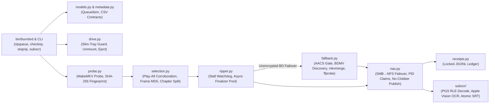

# burndvd

Decoupled macOS optical-disc ripping, verification, unencrypted-Blu-ray `mkvmerge` fallback, and Apple Vision HDMV PGS subtitle OCR library and CLI toolkit for Plex/Jellyfin media libraries.

Designed for unattended multi-drive batch ripping with strict data-safety invariants: no silent overwrites, atomic hard-link/no-replace NAS publication, durable physical-disc receipt tracking, slim-tray optical drive protection, empirical frame-hash verification of Play-All titles, and fail-closed `mkvmerge` fallback for unencrypted Blu-ray discs.

## Architecture



## Package Layout

```text
src/burndvd/
  __init__.py        Public library exports
  config.py          Env-var overrides, binary discovery, thresholds
  models.py          QueueItem, TitleInfo, TrackInfo, RipResult, FallbackResult, CSV/state I/O
  metadata.py        Volume-label inference & verified TV episode contracts
  drive.py           Drive enumeration, BU40N slim-tray guard, targeted unmount/eject/respin
  probe.py           MakeMKV robot-mode probing, disc fingerprinting, ffprobe helpers
  selection.py       Play-All detection, structural corroboration, frame MD5 verify, chapter splitting
  fallback.py        Fail-closed unencrypted-BD mkvmerge remux & ffprobe verification engine
  nas.py             SMB->NFS failover, atomic no-clobber publish, PID claims, locks, review quarantine
  receipts.py        Locked JSONL physical-disc receipt ledger & duplicate-disc guard
  ripper.py          Rip orchestration, double-feature handling, background finalizer pool
  subocr/
    tracks.py        mkvmerge -J track probing, ISO 639-2/B->T normalization, mkvpropedit defaults
    pgs.py           HDMV PGS .sup binary parser, RLE decoder, crop clamping, forced-only filtering
    vision.py        Lazy PyObjC Apple Vision accurate OCR bridge
    srt.py           Atomic .part + fsync + os.replace SubRip writer
    pipeline.py      Per-MKV OCR pipeline & kernel-managed fcntl.flock serialization
  cli/
    ripqueue.py      burndvd-queue CLI
    checkrip.py      checkrip CLI & active-rip / directory verifier
    stoprip.py       stoprip CLI (SIGSTOP -> rescue -> guaranteed SIGKILL)
    rip_progress.py  rip-progress live upload tracker
    subocr.py        subocr CLI
    metadata.py      burndvd-metadata helper CLI
bin/
  burndvd            Interactive single-disc wrapper with detached PTY runner
  discinfo           Read-only MakeMKV title lister with active-rip guard
  ejectdisc          Targeted macOS drutil tray open/close helper
  subocr             Venv-aware wrapper for Apple Vision OCR
```

## Python Library Usage

```python
from pathlib import Path
from burndvd import (
    QueueItem,
    can_use_mkvmerge_fallback,
    discover_bdmv_playlists,
    inspect_rips,
    ocr_mkv,
    planned_rip_selectors,
    remux_playlists_with_mkvmerge,
    select_titles,
)

# 1. Plan titles and skip structurally corroborated Play-All duplicates
item = QueueItem(
    title="Example Show",
    type="tv-season",
    discs=3,
    target_root="/Volumes/Media/TV Shows/Example Show",
    format="BD",
    season=1,
)
title_ids = select_titles(item, probed_info)
selectors, skipped = planned_rip_selectors(item, probed_info, title_ids)

# 2. Fail-closed unencrypted Blu-ray mkvmerge fallback
eligible, reason = can_use_mkvmerge_fallback(Path("/Volumes/UNENCRYPTED_BD"))
if eligible:
    playlists = discover_bdmv_playlists(Path("/Volumes/UNENCRYPTED_BD"), min_dur_s=900)
    result = remux_playlists_with_mkvmerge(playlists, Path("/tmp/staging"), item.title)

# 3. Verify a finished season directory and OCR PGS subtitles
report = inspect_rips("/Volumes/Media/TV Shows/Example Show/Season 01", expected=10)
ocr_mkv("/Volumes/Media/TV Shows/Example Show/Season 01/Example Show - S01E01.mkv")
```

## CLI Reference

| Command | Purpose |
| --- | --- |
| `burndvd` | Smart single-disc interactive frontend (auto-detects drive, format, title, episode contract; launches detached PTY rip) |
| `burndvd-queue --queue queue.csv --state state.json` | Batch multi-disc queue runner with stall watchdog, async NAS finalize, `--verify`, and automatic unencrypted-BD fallback (`--no-mkvmerge-fallback` to disable) |
| `checkrip [dir] [--expected N] [--json]` | Live speed/log-tail monitor for active rips, or read-only audit for play-all blobs, numbering gaps, and edge-hashed duplicates |
| `stoprip [--device disc:N \| --state PATH \| --pid PID \| --all]` | Multi-drive-safe cancel: `SIGSTOP` chain, rescue completed `.mkv`s, guaranteed `SIGKILL` in `finally:` |
| `rip-progress` | Throughput and ETA for in-flight staging -> NAS transfers (supports hidden `.partial` files over NFS) |
| `discinfo [drive_idx]` | Read-only title table dump via `makemkvcon info` (refuses to run while a rip holds a drive) |
| `ejectdisc [drive_idx] [eject\|close]` | Targeted macOS `drutil` tray control |
| `subocr <mkv\|dir>... [--langs eng,spa,zho] [--dry-run]` | Apple Vision HDMV PGS bitmap subtitle OCR into external `.srt` sidecars + `mkvpropedit` audio default selection |

## Data-Safety Guarantees

- **Atomic No-Clobber Publication:** TV rips stage locally, copy to an out-of-library `.partial` file, `fsync()`, and publish atomically via `renameatx_np(RENAME_EXCL)` / `os.link()` — never overwriting existing episodes or exposing half-written files to media servers.
- **PID-Bound Slot Claims & Host-Local Locks:** Concurrent multi-drive rips coordinate via host-local `flock` unified across SMB/NFS mount views and inode-checked `.burndvd-claim` files with dead-PID recovery.
- **Durable Physical-Disc Receipt Ledger:** SHA-256 title-table fingerprints are recorded to an `flock`+`fsync` JSONL ledger only after `ffmpeg` decode verification passes, blocking accidental duplicate disc publication.
- **Isolated Review Quarantine:** Re-rips of occupied TV episode ranges automatically route into fingerprint- and attempt-scoped directories outside all TV libraries.
- **Slim-Tray Drive Protection:** Non-motorized slim drives (e.g. LG BU40N) skip tray-eject respins so a spring tray is never popped open mid-batch.
- **Empirical Play-All Verification:** Heuristic Play-All flags are corroborated structurally before ripping (requiring >= 3 episodes and byte-total agreement) or verified empirically post-rip via decoded frame MD5s; refuted flags are salvaged to `Extras/`.
- **Fail-Closed Unencrypted-BD `mkvmerge` Fallback:** If MakeMKV stalls or errors on a BD, `fallback.py` verifies `BDMV/PLAYLIST` exists and `AACS/` is completely absent (failing closed on any encrypted disc), filters out Play-All playlists, remuxes via `mkvmerge` (tolerating `rc == 1` non-fatal mux warnings, failing closed on `rc >= 2`), and verifies every output `.mkv` with `ffprobe` (size, duration, video + audio streams) before entering the standard no-clobber NAS publish + receipt + `subocr` pipeline.
- **Apple Vision PGS OCR:** Uses `mkvmerge -J` track IDs (immune to attachment index shifts), normalizes ISO 639-2/B codes (`chi->zho`, `fre->fra`, `ger->deu`), enforces row bounds and crop clamping in PGS RLE decoding, supports single-track `forced_only` composition filtering, serializes via kernel `fcntl.flock`, and writes `.srt` files atomically via `.part` + `fsync` + `os.replace`.

## Configuration (Environment Variables)

| Variable | Default | Description |
| --- | --- | --- |
| `BURNDVD_MEDIA_ROOT` | `/Volumes/Media` | Primary SMB media library root |
| `BURNDVD_NFS_MEDIA_ROOT` | `/private/nas/media` | Atomic NFS mirror root for failover & TV no-clobber publish |
| `BURNDVD_STAGING_DIR` | `~/.cache/burndvd/staging` | Local SSD staging directory |
| `BURNDVD_LOCK_DIR` | `~/.cache/burndvd/locks` | Host-local season lock directory |
| `BURNDVD_RECEIPTS_PATH` | `~/.local/state/burndvd/disc-receipts.jsonl` | Durable JSONL receipt ledger |
| `BURNDVD_SLACK_WEBHOOK` | *(unset)* | Optional Slack Incoming Webhook URL for failure alerts |
| `SUBOCR_VENV` | `~/.local/share/subocr/venv` | PyObjC virtual environment for Apple Vision OCR |

## Installation & Tests

```sh
# Editable install (core library + CLI entrypoints)
pip install --no-build-isolation --no-deps -e .

# Optional Apple Vision OCR dependencies (macOS)
pip install -e ".[ocr]"

# Run the full test suite (hardware-free)
pytest -v
```

## License

MIT — see `LICENSE`.
